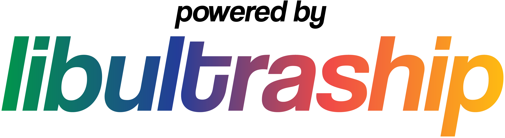

[comment]: <> (Todo: Make Light Mode Image)
[comment]: <> (Todo: Make Dark Mode Image)

# Zelda Majora's Mask NXT - NPC BOTS - JRPG Stats - Leveling EXP Progression - Battle Arena Season Mode

## Done:

- BOTS

## To Do:

- JRPG Stats

- Leveling EXP Progression

- Battle Arena Season Mode

## Discord

Official Discord: https://discord.gg/GjUChjYUKE

# Quick Start

2Ship does not include any copyrighted assets.  You are required to provide a supported copy of the game.

### 1. Verify your ROM dump
You can verify you have dumped a supported copy of the game by using the compatibility checker at https://2ship.equipment/. If you'd prefer to manually validate your ROM dump, you can cross-reference its `sha1` hash with the hashes [here](docs/supportedHashes.json).

### 2. Download 2 Ship 2 Harkinian from [Releases]

### 3. Launch the Game!

#### Windows
* Extract the zip
* Launch `2ship.exe`

#### Linux
* Place your supported copy of the game in the same folder as the appimage.
* Execute `2ship.appimage`. You may have to `chmod +x` the appimage via terminal.

#### macOS
* Run `2ship.app`.
* When prompted, select your supported copy of the game.

### 4. Play!

Congratulations, you are now sailing with 2 Ship 2 Harkinian! Have fun!

# Configuration

### Default keyboard configuration
| N64 | A | B | Z | Start | Analog stick | C buttons | D-Pad |
| - | - | - | - | - | - | - | - |
| Keyboard | X | C | Z | Space | WASD | Arrow keys | TFGH |

### Other shortcuts
| Keys | Action |
| - | - |
| F1 | Toggle menubar |
| F11 | Fullscreen |
| Tab | Toggle Alternate assets |
| Ctrl+R | Reset |

### Graphics Backends
Currently, there are three rendering APIs supported: DirectX 11 (Windows), OpenGL (all platforms), and Metal (macOS). You can change which API to use in the `Settings` menu of the menubar, which requires a restart.

If you're having an issue with crashing, you can also change the API manually in the `2ship2harkinian.json` file by finding the `"Backend": {` section and updating the backend ID and name. Be sure to use one of the valid values:

- `0` = DirectX 11 (default on Windows)
- `1` = OpenGL
- `2` = Metal (default on macOS)

# Custom Assets

Custom assets are packed in `.o2r` or `.otr` files. To use custom assets, place them in the `mods` folder.

If you're interested in creating and/or packing your own custom asset `.o2r`/`.otr` files, check out the following tools:
* [**retro - OTR and O2R generator**](https://github.com/HarbourMasters64/retro)
* [**fast64 - Blender plugin (Note that MM is not fully supported at this time)**](https://github.com/HarbourMasters/fast64)

# Development

If you want to manually compile 2S2H, please consult the [building instructions](docs/BUILDING.md).

<a href="https://github.com/Kenix3/libultraship/">
  <picture>
    <source media="(prefers-color-scheme: dark)" srcset="./docs/poweredbylus.darkmode.png">
    
  </picture>
</a>

